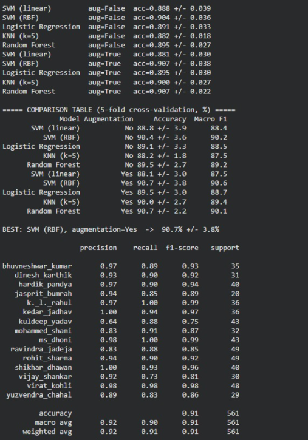
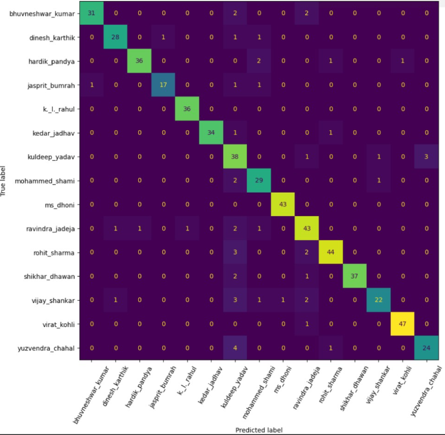
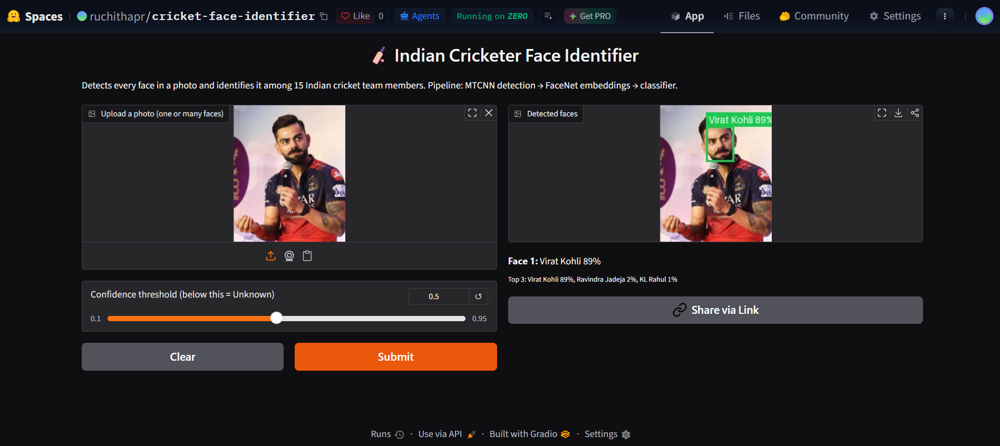
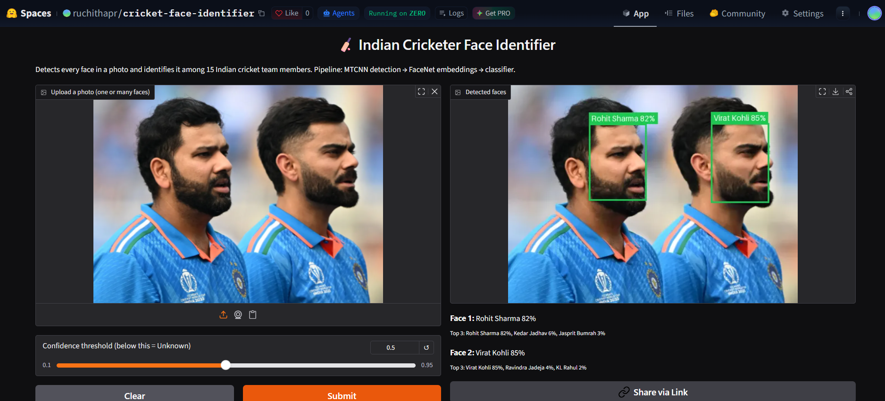
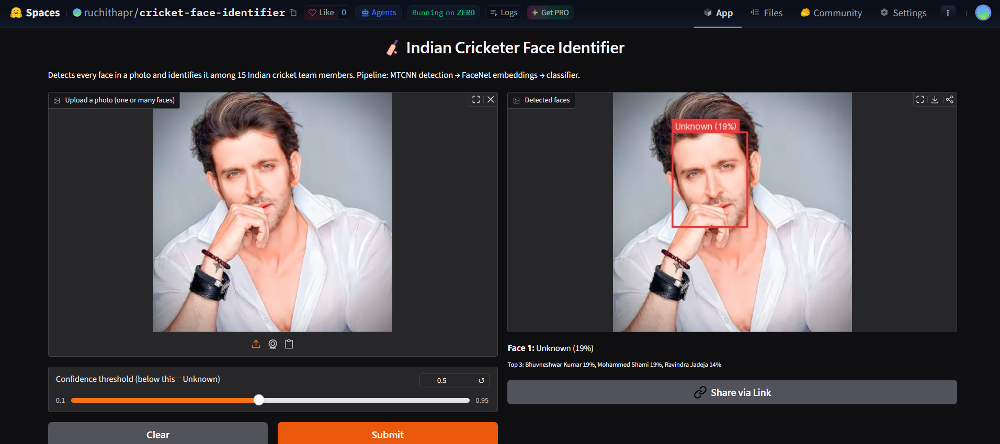

# Indian Cricket Team Member Face Identification

A computer-vision system that identifies Indian cricket team members from a photo.
It detects every face in an image, names each one, and shows confidence scores.

**Live demo:** https://huggingface.co/spaces/ruchithapr/cricket-face-identifier

## Method
1. **Face detection:** MTCNN
2. **Feature extraction:** FaceNet (InceptionResnetV1, pretrained on VGGFace2), giving a 512-dimensional embedding per face
3. **Data augmentation:** horizontal flip, brighter and darker versions (training data only)
4. **Classification:** five classifiers compared (linear SVM, RBF SVM, Logistic Regression, KNN, Random Forest)
5. **Evaluation:** stratified 5-fold cross-validation

## Results
- Players: 15
- Best model: SVM (RBF), augmentation=Yes  ->  90.7% +/- 3.8%
- Cross-validated accuracy: 91%

## Screenshots
| Model comparison | Confusion matrix |
|---|---|
|  |  |

| Single face | Multiple faces | Unrelated photo |
|---|---|---|
|  |  |  |

## Project structure
- `notebook/`: Google Colab notebook (training, cross-validation, comparison)
- `huggingface_app/`: deployed web app (Gradio) and trained model
- `report/`: project report
- `screenshots/`: results and app screenshots
- `train.py`, `predict.py`, `common.py`, `app.py`: earlier local version (Streamlit)

## Dataset
Kaggle: "Indian Cricketers Images" (15 players). The images are not included in this repository.

## Limitations
- Recognizes only these 15 players; other people may be matched to the closest player unless the confidence threshold marks them Unknown.
- Accuracy can drop with unusual angles, occlusion, or low resolution.